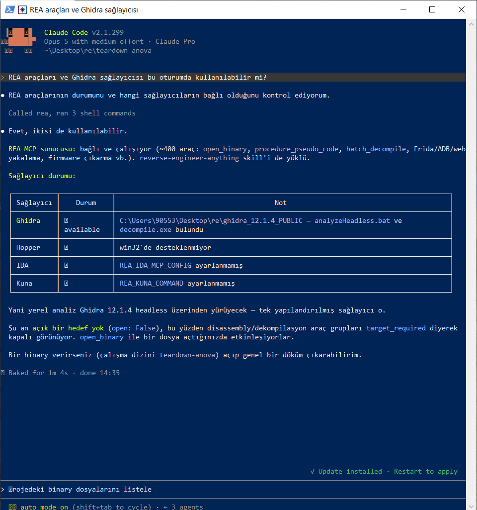

# YZM301 Teardown Sprint — Tek yönlü ANOVA güç analizi

G*Power 3.1.9.7'nin **"F tests → ANOVA: Fixed effects, omnibus, one-way"** hesabı REA + Ghidra ile söküldü, kanıtlandı, temiz odada yeniden yazıldı ve G*Power ile ölçüldü. Ardından hesap motoru az token harcayan bir CLI'nin, bir MCP sunucusunun ve Türkçe soru anlayan bir ajanın arkasına konuldu.

> Bu yazılım **G*Power değildir** ve onun yerine geçmez. G*Power'ın yazarlarına atıf: aşağıda, [Atıf](#atıf-ve-etik).
> Test ailesi: **3 · F testi, tek yönlü ANOVA (üç tedavi kolu)**. Bireysel çalışma.

## Tamamlanan katmanlar

| Katman | Durum | Kanıt |
|---|---|---|
| **Temel: motor + CLI + diferansiyel test** (85) | ✅ CLI hocanın sözleşmesine ([CONTRACT.md v1.0.0](https://gist.github.com/seyyah/08d3e031781d853b17366be8ba264211)) birebir uyar | [`tests/UYUM_RAPORU.md`](tests/UYUM_RAPORU.md), [`CONTRACT_NOTES.md`](CONTRACT_NOTES.md) |
| **Bonus kapısı:** a priori N tam eşleşme ≥ %90 | ✅ **26/26 = %100** G*Power vektörlerinde; sözleşme referans vektörü de tam (N = 305) | aynı rapor |
| **+15 MCP sunucusu** | ✅ tek araç `power_analysis` (sözleşme §7) | [`MCP_SCHEMA.md`](MCP_SCHEMA.md), `tests/test_mcp.py` (65 vakada CLI ≡ MCP, bayt bayt) |
| **+10 AI ajanı** (MCP üzerinden, Türkçe) | ✅ ajan + 10 soruluk set + ölçüm betiği hazır · ⏳ ölçüm sonuçları | [`agent/`](agent/), [`agent/EVAL_REPORT.md`](agent/EVAL_REPORT.md), [`logs/agent_calls.jsonl`](logs/agent_calls.jsonl) |
| İsteğe bağlı: Sistem 1 modeli (Jev) | ➖ Jev erişimi yok. Yönergenin izin verdiği gibi aynı etiket setine kısıtlanmış bir LLM kullanıldı (etiket + güven, eşik 0.75). | [`agent/AGENT_PROMPT.md`](agent/AGENT_PROMPT.md) |

## Sonuç özeti

| Ölçü | Değer |
|---|---|
| G*Power kâhini (arayüzden elle, ekran görüntülü) | **50 vektör**: 27 a priori, 9 geçersiz/sınır girdi, 14 post hoc |
| Uyum (λ, kritik F, df₁, df₂, N, güç, uyarı/hata) | **50 / 50**: 45 tam uyum + 5 sözleşme gereği bilinçli fark (motor bu 5'inde de G*Power ile aynı), uyuşmayan **0** |
| N tam eşleşme (a priori) | **26 / 26** |
| Hata vektörlerinde sözleşme `code` eşleşmesi | **10 / 10** |
| Hocanın referans vektörleri (anova a-priori, post-hoc) | **2 / 2**, en büyük fark 2.7e-08 (tolerans 1e-6) |
| Kütüphane kâhini (statsmodels 0.14.0) | 570 vektör. A priori 450/450 (yuvarlama kuralıyla). Post hoc 51 vektörde 1e-6 toleransını aşan (en fazla 1.2e-5) fark: bağımsız hakem her birinde yeniden yazımı doğruladı, açıklanamayan fark **0**. |
| Birim + bileşen + sistem testleri | 80 test (`python -m unittest discover -s tests`) |
| `[REA]` etiketli kanıt satırı | **44 / 50** ([`LEDGER.md`](LEDGER.md)) |
| Diferansiyel testin bulduğu gizli kural | Kesirli k ve N **en yakın tam sayıya** yuvarlanır (2.4 → 2, 2.5 → 3, 159.6 → 160). Ajanın tahmini yanlıştı, bkz. [`HALLUCINATIONS.md`](HALLUCINATIONS.md) H1. |

**Kılavuzda yazmayan, binary'den kanıtlanan davranışlar** (ayrıntı `LEDGER.md`, kural `SPEC.md`):
- A priori çözücü: sürekli güç fonksiyonunda **Brent kök bulucu** (en fazla 300 iterasyon). Başlangıç aralığı **[k+1, k+100]**, kök bulunamazsa **×1.6** ile genişletilir (L21–L28).
- Yuvarlama: **N = ⌈N_sürekli / k⌉ · k**. Toplam N her zaman k'nın katıdır; en küçük tam sayı değil (A02: 158 değil **159**) (L29).
- Alt sınır: grup başına **en az 2** (f = 3, f = 10 ve güç = α için N = 6) (L31).
- Gerçek güç, yuvarlanmış N ile **yeniden hesaplanır** (L32).
- Post hoc: N, k'nın katı değilse hata vermez; **uyarı** verir ve hesabı yine yapar (L36–L37).
- Aralıklar: α ve güç **[1e-07, 0.9999999]**; f a priori'de **[1e-06, 50]**, post hoc'ta **[0, 50]**; güç ≥ α ve **eşitlik kabul** (L40–L43).

---

## Kurulum

Gerekenler: Python 3.10+, `numpy`, `scipy`. Windows'ta en kolayı **Anaconda Prompt**'tur. Paket kurmak gerekmez; repo kökündeki sarmalayıcılar `PYTHONPATH`'i kendisi ayarlar.

```bat
git clone <bu repo>
cd <repo>
python -m unittest discover -s tests        :: 80 test
```

İsteğe bağlı kurulum: `pip install -e .` → `gpower-clone` komutu PATH'e girer.

## Çalıştırma — CLI

CLI, hocanın sözleşmesine ([CONTRACT.md v1.0.0](https://gist.github.com/seyyah/08d3e031781d853b17366be8ba264211); repo içi özet: [`CONTRACT_NOTES.md`](CONTRACT_NOTES.md)) birebir uyar.

```bat
gpower-clone --version
{"contract_version":"1.0.0","name":"teardown-anova","engine":"Python 3.13.16 + scipy 1.18.1"}

gpower-clone --test anova-oneway --mode a-priori --f 0.25 --alpha 0.05 --power 0.95 --groups 10
{"ncp":24.375,"critical_f":1.9045377336382838,"df1":9,"df2":380,"n_total":390,"actual_power":0.9523634097317241,"n_per_group":39}

gpower-clone --test anova-oneway --mode post-hoc --f 0.25 --alpha 0.05 --n_total 100 --groups 3
{"ncp":6.25,"critical_f":3.0901866751548597,"df1":2,"df2":97,"power":0.5885389408443866,"n_total":100,"n_per_group":null,"warning":"The total sample size (100) is not a multiple of the number of groups (3). The analysis was based on the average group size."}
   (uyarı ayrıca stderr'e yazılır)

gpower-clone --test anova-oneway --mode a-priori --f 0.25 --alpha 0.05 --power 0.04 --groups 3
{"error":"Power must be greater than or equal to alpha.","code":"INCONSISTENT","field":"power"}      (çıkış kodu 2)
```

Unix'te `./gpower-clone`, Windows'ta `gpower-clone` (`gpower-clone.cmd`). Doğrudan çağrı: `python -m anova_clone.cli` (`PYTHONPATH=src`).

### Sözleşmeye uyum

| Kural | Uygulama |
|---|---|
| Girdiler | a-priori: `--f --alpha --power --groups`; post-hoc: `--f --alpha --n_total --groups` |
| Çıktılar | a-priori: `ncp, critical_f, df1, df2, n_total, actual_power`; post-hoc: `ncp, critical_f, df1, df2, power` (+ ek anahtarlar `n_per_group`, post-hoc'ta `n_total`, `warning`) |
| Sayılar | Tam double, yuvarlama yok; `n_total`, `df1`, `df2` JSON tam sayı |
| stdout / stderr | stdout'ta her durumda tek satır JSON; uyarı stderr'e |
| Hata | `{"error","code","field"}`; çıkış 2 geçersiz girdi, 1 `NO_SOLUTION` |
| Kodlar | `MISSING_PARAM`, `UNKNOWN_PARAM` (tanınmayan **veya moda ilgisiz** alan), `INVALID_VALUE`, `OUT_OF_RANGE`, `INCONSISTENT`, `UNSUPPORTED` (başka aile; bonus modlar compromise/criterion/sensitivity), `NO_SOLUTION` |
| `--version` | `{"contract_version":"1.0.0","name":"teardown-anova","engine":…}` |

**Sözleşme ↔ G*Power ayrılıkları** (ayrıntı: [`ASSUMPTIONS.md`](ASSUMPTIONS.md), [`tests/UYUM_RAPORU.md`](tests/UYUM_RAPORU.md)):
- **Kesirli k ve N** (2.5, 159.6): G*Power en yakın tam sayıya yuvarlar (bizim diferansiyel test bulgumuz, SPEC R35). Sözleşme ise `INVALID_VALUE` ister. CLI ve MCP sözleşmeye uyar, motor G*Power davranışını korur.
- **Post-hoc f = 0:** G*Power kabul eder ve güç = α döner (P07). Sözleşme f > 0 ister, bu yüzden CLI `OUT_OF_RANGE` verir.
- **Güç = α:** G*Power kabul eder (A21, kâhinde gözlendi), CLI de kabul eder. Sözleşmedeki örnek mesaj ("Power, alpha değerinden büyük olmalı") katı eşitsizlik gibi okunabilir. Bu noktada G*Power'ın gözlenen davranışı esas alındı.
- **"3.0" gibi tam sayı değerli ondalık:** tam sayı olarak kabul edilir.

## MCP sunucusu (+15)

```bat
claude mcp add anova-power --scope project -- cmd /c anova-mcp.cmd
```

Repo kökündeki `.mcp.json` aynı kaydı içerir. Sözleşme §7'deki gibi **tek araç** var: `power_analysis`. Girdisi CLI ile aynı alan adlarıdır (`test`, `mode` zorunlu; `f`, `alpha`, `power`, `groups`, `n_total` moda göre). Çıktı, CLI stdout'uyla bayt bayt aynı JSON'dur (text content + `structuredContent`); hatada aynı hata JSON'u `isError: true` ile döner. **Araç şeması, girdi/çıktı alanları ve örnek istek/yanıt: [`MCP_SCHEMA.md`](MCP_SCHEMA.md).**

MCP ince bir adaptördür: `mcp_server.py` → `cli.run(params)` → `engine`. Formül, aralık kontrolü ve yuvarlama yalnızca `engine.py`'dedir. Bunu bir AST testi denetler: MCP katmanı `engine`, `scipy` veya `math` içe aktarmaz. `tests/test_mcp.py` eşdeğerliği şu vakalarda doğrular: 50 kâhin vektörü, sözleşmenin 5 anova referans vektörü ve her hata kodundan örnekler. Her birinde CLI ile MCP çıktısı bayt bayt aynıdır.

## AI ajanı (+10)

Ajan = **Claude Code** (headless `claude -p`) + bu reponun MCP sunucusu + [`agent/AGENT_PROMPT.md`](agent/AGENT_PROMPT.md). Ayrı bir API anahtarı gerekmez.
- Ajan önce soruyu etiketler (`t2-indep, t-paired, anova-oneway, chi2-contingency, multireg-r2, ambiguous, unsupported`) ve bir güven değeri verir. Etiket `anova-oneway` değilse **ya da güven < 0.75 ise** aracı çağırmaz, araştırmacıya sorar.
- **Hesap yapmaz:** sayı yalnızca MCP aracından gelir. `Bash` dahil hesap yapabilecek tüm araçlar kapalıdır (`--disallowedTools`).
- 10 soruluk set: [`agent/eval_questions.json`](agent/eval_questions.json). 8 desteklenen soru var ve beklenen N/güç değerleri **G*Power kâhininden** alınmıştır. Bir soru t testidir (desteklenmez), bir soru da eksik bilgilidir (sorması gerekir). Her sorunun İngilizce çevirisi de var.
- Ölçüm: `python agent/run_eval.py`. Aynı soruları **MCP yolu** ve **GUI yolu** (MCP yok, G*Power ekran görüntülerini okuyarak) ile çözer; token, süre, doğruluk, araç çağrı kayıtları ve güven kalibrasyonunu raporlar. `--langs tr en` ile Türkçe/İngilizce karşılaştırması da yapılır.
- Çıktılar: `agent/EVAL_REPORT.md`, `agent/EVAL_RESULTS.json`; sözleşme §8 biçiminde araç çağrı kaydı **`logs/agent_calls.jsonl`** (`ts, question, tool_input, tool_output, tokens_in, tokens_out`); ham akışlar `agent/logs/*.jsonl`.
- Sözel etki büyüklüğü ("orta") sessizce varsayılmaz: ajan istemi, varsayımın cevapta "Varsayım:" diye açıkça yazılmasını zorunlu tutar (sözleşme §8).

## Diferansiyel test

```bat
python tests\differential.py
```

Kâhin vektörlerini **CLI üzerinden** (gizli vektörlerin çalıştırılacağı yolun ta kendisi) koşturur ve [`tests/UYUM_RAPORU.md`](tests/UYUM_RAPORU.md), `tests/differential_results.csv`, `tests/library_results.csv` dosyalarını üretir. Tolerans sözleşmedeki gibidir: N, df₁ ve df₂ tam eşleşir; ondalıklar mutlak ya da bağıl ≤ 1e-6, ayrıca G*Power'ın gösterdiği basamağa kadar eşleşir. Uyarı, hata ve hata kodu (`code`) da karşılaştırılır. Sözleşmenin anova referans vektörleri de koşturulur.

**İki katmanlı kâhin:**
1. `oracle/gpower_vectors.csv`: G*Power arayüzünden 50 vektör, her biri `oracle/screenshots/<ID>.png` ile. Sınır değerler bilinçli seçildi: çok küçük/büyük f, güç = α ve güç < α, k = 2 ve k = 100, k'ya bölünmeyen N, kesirli k/N, geçersiz girdiler. Neden bu vektörlerin seçildiği: [`oracle/TOPLAMA_REHBERI.md`](oracle/TOPLAMA_REHBERI.md).
2. `oracle/library/statsmodels_vectors.csv`: statsmodels ile 570 vektör (`oracle/library/gen_library_vectors.py`). Kütüphane N'yi kesirli verir, G*Power yukarı yuvarlar; bu fark raporda açıklanır.

---

## Nasıl yapıldı: koddan kanıta, kanıttan spec'e

| Adım | Ne yapıldı | Çıktı |
|---|---|---|
| 1 · Sök | REA 6.7.0 + Ghidra 12.1.4, Claude Code oturumu | `prompts/session1_inceleme.md` (ilk prompt) |
| 2 · Kanıtla | Her iddia `[REA]`/`[DOK]`/`[AJAN]` etiketiyle, fonksiyon/dize adresiyle | [`LEDGER.md`](LEDGER.md) |
| 3 · Spec çıkar | Kabul kriterleri Gherkin; v1.1 diferansiyel test bulgularıyla güncellendi | [`SPEC.md`](SPEC.md) |
| 4 · Yeniden yaz | Temiz oda: ayrı ajan oturumu, yalnızca SPEC.md + kâhin değerleri | `src/`, `prompts/session2_yazim.md`, [`ASSUMPTIONS.md`](ASSUMPTIONS.md), [`SESSION2_LOG.md`](SESSION2_LOG.md) |
| 5 · Diferansiyel test | G*Power + kütüphane kâhini, CLI üzerinden | [`tests/UYUM_RAPORU.md`](tests/UYUM_RAPORU.md) |
| 6 · Ajan çağına taşı | CLI → MCP → ajan | [`MCP_SCHEMA.md`](MCP_SCHEMA.md), [`agent/`](agent/) |

**Temiz oda nasıl sağlandı:** İnceleme oturumu (Claude Code, kullanıcının Windows makinesi) yalnızca `LEDGER.md` ve `SPEC.md` üretti. Yazım oturumu ise ayrı bir ajandı ve boş bir klasörde başlatıldı. Ona yalnızca `SPEC.md` ve `oracle/gpower_vectors.csv` (G*Power **arayüzünden** okunan sayılar, decompile değil) verildi; klasör dışına bakmaması talimatıyla çalıştı (`SESSION2_LOG.md`). SPEC v1.1'deki düzeltmelerin kaynağı da binary değil, kâhindir (`[KÂHİN]`). Teslim edilen kodda decompile çıktısı yoktur. `GPowerNT.exe` repoda yoktur (`.gitignore`).

**"Ajanın söktüğü şeyin doğru olduğunu nasıl kanıtlarsın?"** Ajanın iddiası tek başına kanıt sayılmadı:
- **Statik doğrulama:** her kural bir `[REA]` adresine bağlandı.
- **Dinamik doğrulama:** her kural G*Power'ın kendisine karşı ölçüldü (diferansiyel test).
- İki yol ayrıştığında **kara kutu kazandı**. Örnek: L48 `[AJAN]` iddiası X07/X09'da çürüdü ve SPEC buna göre düzeltildi.

Ayrıntılar: [`HALLUCINATIONS.md`](HALLUCINATIONS.md), [`AGENT_COST.md`](AGENT_COST.md).

## Sürüm bilgisi (konfigürasyon yönetimi)

| | |
|---|---|
| İncelenen binary | G*Power **3.1.9.7** (Windows), `GPowerNT.exe`, resmi sayfadan (psychologie.hhu.de) |
| **GPowerNT.exe SHA-256** | `C63E6A133EB6372932F810C08CC33DC35A06D1DDB658F897BD6C34A754EFC812` |
| Sürüm kanıtı | [`docs/gpower_about.png`](docs/gpower_about.png), [`docs/BINARY.md`](docs/BINARY.md) |
| Not | Yönerge dosyayı `GPower.exe` diye anıyor; 3.1.9.7 zip'inde çalıştırılabilir dosyanın adı `GPowerNT.exe` |
| Sözleşme | CONTRACT.md v1.0.0 (`--version`) |
| Araçlar | REA (npm `rea-agents`) 6.7.0, Ghidra 12.1.4, Temurin JDK 21.0.12, Node 24.21, Claude Code 2.1.299 |
| REA/Ghidra kontrolü | *"REA araçları ve Ghidra sağlayıcısı bu oturumda kullanılabilir mi?"* →  ([`docs/rea_doctor_ghidra.json`](docs/rea_doctor_ghidra.json)) |
| Host ↔ target | İnceleme: Windows x64 host, 32-bit x86 PE hedef. Yeniden yazım: platformdan bağımsız Python. Ayrıntı: [`SETUP.md`](SETUP.md) |
| Yeniden yazım sürümü | `anova-clone` 1.2 (SPEC v1.1 + sözleşme v1.0.0) |

## Demo

**60 saniyelik CLI videosu:** [docs/demo.mp4](docs/demo.mp4)  
Senaryo ve komutlar: [`docs/DEMO.md`](docs/DEMO.md)

## Repo haritası (yönergedeki teslim listesi)

| Yönerge | Bu repoda |
|---|---|
| SPEC.md (Gherkin) | [`SPEC.md`](SPEC.md) |
| LEDGER.md ([DOK]/[REA]/[AJAN]) | [`LEDGER.md`](LEDGER.md) |
| HALLUCINATIONS.md | [`HALLUCINATIONS.md`](HALLUCINATIONS.md) (6 madde) |
| AGENT_COST.md | [`AGENT_COST.md`](AGENT_COST.md) |
| prompts/ | [`prompts/session1_inceleme.md`](prompts/session1_inceleme.md), [`prompts/session2_yazim.md`](prompts/session2_yazim.md) |
| oracle/ (CSV + ekran görüntüleri) | [`oracle/gpower_vectors.csv`](oracle/gpower_vectors.csv), `oracle/screenshots/`, `oracle/library/` |
| src/ (motor + CLI; MCP ve ajan) | `src/anova_clone/engine.py` (tek motor), `cli.py`, `mcp_server.py`; `agent/` |
| tests/ (diferansiyel test + uyum raporu) | `tests/differential.py`, [`tests/UYUM_RAPORU.md`](tests/UYUM_RAPORU.md), `tests/test_*.py` |
| README (kurulum, çalıştırma, sürüm, hash, demo, atıf) | bu dosya |

## Sommerville bağlantısı (kısa)

- **Doğrulama:** "ürünü doğru mu yapıyoruz?" → yeniden yazım SPEC'e uyuyor mu (`tests/test_spec.py`).
- **Geçerleme:** "doğru ürünü mü yapıyoruz?" → SPEC kara kutunun gerçek davranışı mı (`tests/differential.py`). İkisi ayrı başarısızlıklar yakaladı: H1/H2 yalnızca geçerlemede görüldü.
- **Test seviyeleri:** birim (`engine` fonksiyonları), bileşen (CLI ↔ motor, MCP ↔ CLI arayüzü), sistem (girdi → N, kritik F, λ uçtan uca), kabul (Gherkin + gizli vektörler).
- **Bölüm testi ve sınır değerler:** kâhin vektör seçimi (`oracle/TOPLAMA_REHBERI.md`).
- **TDD'nin tersi:** önce karakterizasyon testi, yani G*Power'ın çıktısı test olarak yakalandı, sonra kod yazıldı.
- **Yeniden kullanım:** soyutlama düzeyinde kalındı, kod değil algoritma alındı.
- **Konfigürasyon yönetimi:** sürüm ve hash. **Host-target geliştirme:** Windows x86 hedef ↔ bağımsız Python yeniden yazımı.

## Bilinen sınırlamalar

- Noncentral F için `scipy.stats.ncf` (Boost) kullanıldı; G*Power DCDFLIB kullanıyor (L04). 40 sayısal vektörde 7 ondalık uyum var. N ≈ 1e12 gibi aşırı uçlarda aynılık doğrulanmadı (`ASSUMPTIONS.md` U03).
- JSON sözleşme gereği tam hassasiyet verir; G*Power ekranda 7 ondalık gösterir. Fark yalnızca yazım biçimindedir.
- Bonus modlar (compromise, criterion, sensitivity) uygulanmadı; `UNSUPPORTED` döner.
- Birden çok alan aynı anda hatalıysa hangi hatanın önce bildirildiği G*Power'da ölçülmedi.
- Ajan değerlendirmesindeki GUI yolu gerçek tıklama yapmaz, hazır ekran görüntüleri okur. Bu yüzden GUI maliyetinin **alt sınırıdır**.

## Atıf ve etik

Bu çalışma YZM301 dersi kapsamında **eğitim amaçlıdır**. Yalnızca G*Power 3.1.9.7 (Windows) incelendi. G*Power ücretsizdir; satışı ve resmi sayfa dışında dağıtımı yasaktır. Bu repo G*Power'ı içermez ve dağıtmaz. Yazarların bilim dünyasına sunduğu emeğe saygıyla:

- Faul, F., Erdfelder, E., Lang, A.-G., & Buchner, A. (2007). G*Power 3: A flexible statistical power analysis program for the social, behavioral, and biomedical sciences. *Behavior Research Methods, 39*(2), 175–191.
- Faul, F., Erdfelder, E., Buchner, A., & Lang, A.-G. (2009). Statistical power analyses using G*Power 3.1: Tests for correlation and regression analyses. *Behavior Research Methods, 41*(4), 1149–1160.

Ticari tersine mühendislik aracı kullanılmadı; yalnızca Ghidra (açık kaynak) ve REA kullanıldı. Ajanlara gönderilen tüm klinik senaryolar kurgusaldır; gerçek hasta verisi yoktur.
